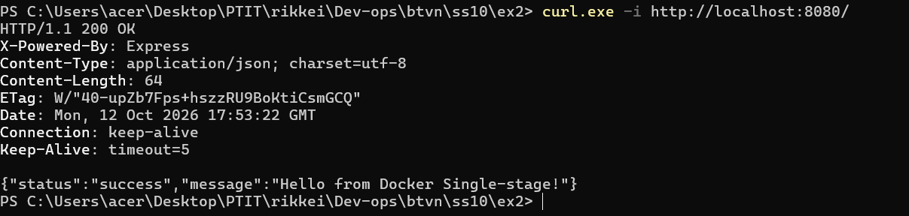

# Bài 2: Đóng gói ứng dụng Web Backend bằng Single-stage Dockerfile

## 1. Giới thiệu
Đóng gói ứng dụng Web Backend (Node.js/Express) thành Docker Image bằng Single-stage Dockerfile chuẩn hóa để triển khai lên môi trường chạy thử nghiệm.

---

## 2. Cấu trúc thư mục
```
homework/session_10/ex2/
├── Dockerfile
├── .dockerignore
├── package.json
├── server.js
├── README.md
└── result.png   <-- Ảnh chụp kết quả đặt tại đây
```

---

## 3. Mã nguồn & Dockerfile

### Dockerfile
```dockerfile
# 1. Base image
FROM node:18-alpine

# 2. Thư mục làm việc bên trong container
WORKDIR /app

# 3. Biến môi trường PORT
ENV PORT=3000

# 4. Sao chép package.json trước để tận dụng cache
COPY package*.json ./

# 5. Cài đặt dependencies
RUN npm install

# 6. Sao chép toàn bộ mã nguồn vào container
COPY . .

# 7. Khai báo cổng lắng nghe
EXPOSE 3000

# 8. Lệnh khởi chạy ứng dụng (exec form)
CMD ["node", "server.js"]
```

---

## 4. Các bước thực hiện & Kiểm tra

1. **Build Docker Image:**
   ```bash
   docker build -t hw-backend:v1 .
   ```

2. **Chạy Docker Container:**
   ```bash
   docker run -d --name app-single-stage -p 8080:3000 hw-backend:v1
   ```

3. **Kiểm tra trạng thái Container:**
   ```bash
   docker ps
   ```

4. **Kiểm tra Logs:**
   ```bash
   docker logs app-single-stage
   ```

5. **Kiểm tra phản hồi API:**
   ```bash
   curl.exe -i http://localhost:8080/
   ```

---

## 5. Kết quả thực thi

> **Minh chứng hoàn thành bài tập (Bao gồm trạng thái build, container Up, logs và kết quả curl):**


